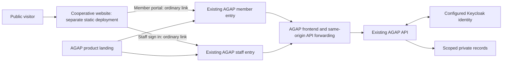

# Cooperative public website implementation plan

23 November 2026, Asia/Manila. Task **WEB-COOP-01**. Planning baseline: `c3fd889`.

**Status: proposed implementation; no cooperative website, domain, hosting change or accepted visual design is supplied.** The user requests a cooperative commercial website alongside AGAP's product landing. Cooperative identity, final hostname, approved content and first-release form requirements remain open. For planning, use an informational site with contact details and portal links, and `coop.agap.software` as an illustrative hostname. Neither is a confirmed institution decision. The historical partner context does not authorize publication of its name, logo, private documents or policies.

## 1. Outcome and contract proposal

Provide a public website where visitors can learn about the cooperative, membership, approved services, announcements and contact options. Existing members and staff continue into AGAP's authenticated workspaces through clearly named links. AGAP's current product landing retains its product/demo purpose.

Robert owns the website/frontend, shared controls, routing, identity, configuration, infrastructure and integration proposal. The cooperative must name its content approver and ongoing publisher. Aaron reviews any published product/policy descriptions; Benedict reviews wording about applications/decisions; Earl reviews accounting/payment/support statements when present. These are proposed review handoffs, not new assignments, transferred ownership or recorded acceptance.

Before changing shared implementation, adopt the following proposed boundary:

- A separate public frontend and deployment in this repository, with its own build output and domain. Reuse approved tokens and suitable presentational controls; keep portal state, private data and authentication on the existing portal origin.
- Initial connection is ordinary navigation to the current member/staff routes. No new login, membership authority, public loan application API, cross-origin private API access or hostname-based organization selection.
- Public content is explicitly approved and source-controlled for release one. An editor CMS, inquiry processing and public membership onboarding are separate additions if requested.
- [Product solution](AGAP_Product_Solution.md) governs scope; [architecture](AGAP_Production_Architecture.md) and [delivery plan](AGAP_Delivery_Plan.md) govern boundaries. [design.md](../design.md) remains the sole visual/interaction authority. Cooperative visual requirements must be proposed there before UI implementation; this plan does not define another design system.

## 2. Repository findings

| Inspected implementation | Consequence for this plan |
| --- | --- |
| [Root](../src/app/Root.tsx) lazy-loads the product landing at `/`; [main](../src/main.tsx) uses hash routing | A DNS alias alone would display the same product landing. A separate website needs its own artifact/routing; adding a subdomain does not select cooperative content automatically. |
| [Product landing](../src/features/landing/LandingPage.tsx) already links to member/staff entry | Preserve this page; the cooperative site will offer additional entry points. |
| [Identity](../apps/api/src/modules/identity/identity.service.ts) builds exact callbacks and checks CSRF against one `PUBLIC_ORIGIN` | Retain that origin for release one. Adding a public site does not require adding it to private API origins or OIDC redirects. |
| [API](../apps/api/src/app.ts) and [member controller](../apps/api/src/modules/member-portal/member.controller.ts) issue separate cookies without a shared parent-domain attribute | Preserve host-bound sessions and staff/member separation. Do not widen cookie scope for the public website. |
| [Vercel preparation](../infra/azure/prepare-vercel.mjs) configures same-origin `/api/*` forwarding to Azure | That rewrite belongs only on the portal deployment. A static cooperative deployment must not inherit it. |
| [Recorded deployment evidence](AGAP_Verification.md#vercel-frontend-deployment--6-november-2026) identifies `www.agap.software` and the root redirect | Use this as recorded context, not proof of today's DNS, current project linkage or live API/identity readiness. Those require a fresh deployment inventory. |

No cloud account, current DNS record, paid-plan status or new live deployment was verified during this planning task. The hosted API/identity and institutional production gates recorded in the existing architecture remain separate work.

## 3. Domain and deployment wiring

Recommended first release:

| Address | Responsibility | Action |
| --- | --- | --- |
| `https://www.agap.software/` | AGAP product landing and existing web deployment | Retain existing behavior. |
| `https://coop.agap.software/` | Cooperative public website, illustrative name | Connect to a new public-site project after hostname/content approval. |
| `https://www.agap.software/#/member` | Existing member entry | Public-site **Member portal** link. |
| `https://www.agap.software/#/staff` | Existing staff entry | Public-site **Staff sign in** link. |
| Existing portal `/api/*` and configured identity issuer | Private application/identity boundary | Preserve same-origin API forwarding and existing OIDC flow. |

A cooperative-owned domain such as `www.<approved-cooperative-domain>` can instead be the public site's canonical address. Decide this before canonical URLs, sitemap and public launch. If both names are retained, choose one canonical address and redirect the alias. Domain ownership, renewals and operator access belong to the cooperative's agreed operating arrangement.

The cooperative site serves public content without a private session, database or API dependency. Login starts only after the visitor enters the existing portal and chooses its existing sign-in action. Link navigation carries no credentials, member IDs, private records or arbitrary return destinations. Continue to enforce server-established organization/member/branch scope; a subdomain or a public-site logo grants no authority.

### Optional later portal hostname

`app.agap.software` or `portal.<approved-cooperative-domain>` may be a useful later separation. It is not required for this website and is not a DNS-only change. Before such a move, inventory all absolute links, bookmarks, installed-app identity/start URLs, callback/logout settings and environment-specific API rewrites. Update `PUBLIC_ORIGIN`, exact member/staff callbacks and identity-provider settings together; test session rotation, CSRF, MFA, uploads/downloads, recovery and logout on the selected origin. Host-bound sessions do not transfer automatically; plan explicit sign-in again. Preserve original fragment routes in any approved legacy-entry bridge: URL fragments are not sent to the server, so a server redirect cannot inspect/reconstruct them from the request. Do not promise old POST requests or uncertain commands can be redirected/replayed. Define a tested cutover/rollback before changing existing origins.

## 4. First-release scope and content inputs

The first release can be a focused landing page with ordinary section anchors and separate privacy/accessibility pages. Add full service/news pages only when approved material justifies them. Public pages use real paths; do not duplicate AGAP's hash router for searchable commercial content.

| Public content | Required input and intended action |
| --- | --- |
| Cooperative introduction/about | Approved legal/display name, history, mission, logo and publication permission; learn about the organization. |
| Services | Approved service names, eligibility summaries, terms/disclosures and authoritative source/review date; learn how to ask about a service. Public copy does not configure AGAP offers or imply supported deposit-taking, investments or live lending. |
| Membership | Eligibility, documents, fees/contributions only when approved, process and assisted contact; explain how to join. Existing members enter the normal portal. |
| Announcements | Approved title/body, publication date, optional event/expiry dates, public images and archive policy; do not invent activity or impact figures. |
| Contact/branches | Verified public address, phone/email, office hours, accessibility/assisted contact and public social links; contact/visit the cooperative. Prefer a map link before adding a tracking embed. |
| Member/staff access | Confirmed portal origin, tested entry destinations and honest availability copy. A public launch can precede portal readiness, but must then show contact/coming-soon access rather than claim sign-in works. |
| Privacy/accessibility | Cooperative-approved public notices and responsible contact; distinguish public website information from the portal's authenticated collection/sharing notices. |

Also obtain approved languages/translations, licensed photographs and consent for identifiable people, approver/publisher names, review cadence, domain/DNS access, hosting budget and launch acceptance criteria. Missing material remains an editorial blocker; preview placeholders must be clearly fictional and cannot ship as real cooperative facts.

Release one uses published contact channels; there is no submission-success screen without a real submission service. A request for membership is not existing-member verification, and entering the loan portal is not self-service enrollment.

### Optional scope requiring a separate specification

- **Public inquiry form:** minimal contact/message fields, responsible inbox/queue, privacy notice and retention, abuse limits, server validation, delivery monitoring, failure/retry behavior and safe handling of unknown delivery. No attachments, financial records or automatic member creation by default. Browser bundles contain no mail/API credentials. Never reuse privileged support/loan commands as an anonymous endpoint.
- **Online membership application:** institution-approved eligibility, identity verification, duplicate handling, consent, document protection, approval and linkage/recovery workflow. This is separate from the current operator-verified member linkage and loan application. Do not present a public signup as implemented by the existing portal.
- **CMS/editor interface:** approved editor/publisher roles, draft/review/publish history, sanitized public content, media permissions, rollback and an operating owner. AGAP staff permissions do not automatically grant publishing authority. Start with reviewed repository content unless nondeveloper editing is a launch requirement.

## 5. Proposed implementation structure

Use a separate static Vite application under `apps/coop-site/`, leaving the current root web app in place. Prefer the installed toolchain and no additional runtime framework. Public information and metadata must exist in built HTML and remain readable without JavaScript; Vite bundling alone does not prerender a React SPA. Start with HTML/templates and progressive enhancement, or prove build-time rendering in the technical spike before choosing it.

Proposed paths/scripts are future work, not existing commands:

| Proposed boundary | Purpose and owner |
| --- | --- |
| `apps/coop-site/` | Public pages, approved public assets, scoped styles and content; Robert. |
| `apps/coop-site/vite.config.ts` and project-specific deployment configuration | Independent application root, real-path/static-page handling, output and public headers; Robert. No portal API rewrite, app cookies or private runtime secrets. |
| Public content/configuration inside that app | One validated public content source and explicit environment-specific canonical/portal origins; Robert plus cooperative approver. No copied financial/domain types, fixtures or private source documents. |
| Root npm manifest/lockfile and CI | Propose minimal workspace registration so the separate Vercel application root can use the repository's one install/lockfile and shared source. Confirm this in the build spike; Robert owns the change. No wholesale repo restructure or dependency upgrade is required by this plan. |
| Proposed `dev:coop`, `build:coop`, `check:coop` scripts | Run and validate the independent site; include its build/content/type/link checks in central verification before integration. |
| Cooperative browser tests | Public content/links, no private-session requests, real-path refresh/404, preview configuration and accessibility; extend the existing browser tooling. |

Use existing shared tokens and suitable presentation-only controls where they are compatible with static rendering. Do not import portal providers, generated private API clients, browser fixtures, model code or financial engines into the public site. Robert must review any shared export or new scoped brand-token proposal before implementation. Cooperative appearance and permitted brand assets are resolved through `design.md`, rather than copying the product landing or silently imposing a new palette.

Run the site on a separate proposed local port, for example 5190, with portal links explicitly targeting the existing local portal origin. Check availability before binding. The public site should run without Docker; full sign-in requires the existing `local:dev` dependencies. Do not point preview links silently at production: use explicit preview/local portal targets and make unconfigured targets unavailable.

## 6. Security, search and operations

The public deployment receives only approved public content and public build configuration. Preserve portal HttpOnly/Secure/session/path settings; do not introduce parent-domain cookies, credential sharing, broad CORS or iframe login. Cross-site navigation needs no private API CORS allowance. Keep login proxy trust and rate limiting on the actual portal ingress; the new static site's hostname is not a trusted proxy.

Before launch, ensure the artifact includes meaningful page HTML, unique titles/descriptions, a canonical origin, social metadata, public favicon/logo, sitemap/robots entries for real public pages and a real 404. Public structured data may describe only approved actual facts. Do not publish portal records, fictional product-demo statistics or invented reviews. Preview environments must not become indexed duplicates; robots directives are not access controls for sensitive material.

Use licensed, optimized public images, explicit image dimensions and restrained third-party scripts. Verify security headers/CSP against actual fonts/assets and prevent framing where appropriate. External links must be validated; editable content cannot execute HTML/scripts. Add analytics or tracking embeds only after an approved purpose/vendor/privacy decision; never send member IDs, private portal paths, form contents or tokens to marketing analytics.

Name a publisher, content reviewer and domain/hosting operator. Record how they withdraw outdated announcements, correct rates/hours, renew domain access, monitor uptime/broken entry links and roll back a public deployment. Public-site availability and private portal availability are separately monitored; the public site must remain useful if the API/identity service is unavailable.

## 7. Delivery sequence and acceptance

| Step | Deliverable and dependency | Acceptance gate |
| --- | --- | --- |
| 1. Confirm scope/content | Cooperative, hostname, languages, approved material, publisher, inquiry/onboarding choice and budget | Required facts are supplied or visibly pending; no invented brand/service claims. |
| 2. Technical/build spike | Separate app root, shared lockfile/source access, static rendered sample, preview/local portal configuration and independent Vercel build settings | Both web builds work independently; public artifact has no API rewrite/private state; root AGAP build remains unchanged. Freeze the minimal shared manifest/config proposal before further UI work. |
| 3. UI/content implementation | Proposed amendment in `design.md`, approved content, static pages, SEO/metadata and accessible portal navigation | Review desktop/mobile screenshots and actual rendered content; no competing design guide or duplicated private workflow. |
| 4. Connection/regression | Member/staff entry through normal authentication, unavailable portal state and existing product landing regression | No private network requests on public-page load; correct environment destinations; no open redirect, role grant, cookie widening or altered consent/financial behavior. |
| 5. Staging/release | Separate project, approved DNS/TLS/canonical target, content approval and operator runbook | Full required checks, browser evidence, public-host smoke tests and institutional content acceptance; production portal release remains separate. |

A preliminary allowance is **5–8 engineering days after content and access decisions are supplied** for the bounded informational website, integration and verification. This is a planning estimate, not a delivery commitment. Waiting for branding/approval/DNS, production API/identity work, new hosting procurement, forms, CMS, onboarding and any portal-origin migration are additional dependencies or separately estimated scope.

Implementation verification must include `npm run check` and `npm run test:e2e` plus the new site checks integrated into those gates. Record screenshots at 320/390/768/1366px, keyboard/focus behavior, 200% zoom, reduced motion, link/media failure and content readability with JavaScript disabled. Test direct page visits/reloads and genuine 404s; verify no session read on public load, destination URLs on each environment, existing signed-in/signed-out staff/member paths, logout/CSRF/MFA behavior and absence of private data/secrets in the artifact. Do not duplicate finance tests for a link-only public site; retain the existing regression suite.

## 8. Hosting, DNS and release procedure

Use a second Vercel project connected to this repository with its application root `apps/coop-site/`. Keep the existing project/root/build unchanged. Explicitly configure the new project's installation/build/output settings and shared-source availability; verify the workspace/lockfile build from that root in the spike. Never rely on accidentally inheriting root `vercel.json`, portal rewrites or portal secrets. Distinct projects allow independent public-site preview, promotion and rollback; shared-source changes still require consuming-project checks. Vercel documents this arrangement in [Using Monorepos](https://vercel.com/docs/monorepos) and its [FAQ](https://vercel.com/docs/monorepos/monorepo-faq).

Review the hosting account and budget before choosing a commercial deployment plan. Vercel documents Hobby as personal/noncommercial and directs commercial use to eligible paid plans in its [fair-use guidelines](https://vercel.com/docs/limits/fair-use-guidelines). Do not assume the existing demonstration arrangement covers the cooperative's commercial launch. No upgrade, purchase or provider change is authorized by this planning document.

After approved content passes staging, add the chosen hostname to the **new** project. Obtain the exact DNS/verification records from that project's domain screen, apply only the necessary records through the actual DNS provider, and validate ownership, HTTPS, canonical redirects, deep links and asset paths. Do not invent a CNAME target or replace the product site's apex/`www`, email MX/TXT or existing identity records. Vercel's [domain guide](https://vercel.com/docs/domains/working-with-domains/add-a-domain) describes adding the domain and required verification. DNS propagation depends on the actual provider/TTL and is not a fixed launch-time promise.

Release evidence must identify source revision, hosting project/deployment, approved hostname, tested entry links, content approver/date and rollback revision. Initially roll back by promoting the last known-good **public-site** deployment while leaving the portal/product site unchanged. Record DNS before/after separately if any hostname mapping changes. Observe the public host and portal links after cutover; a documentation push or a working preview alone does not complete this gate.

## 9. Planning verification and remaining decisions

This task changes documentation only. Validate introduced repository links/anchors, authority/status consistency, source-path evidence, domain examples and the absence of application/configuration/lockfile changes. Do not report application tests, DNS verification, screenshots or a hosted deployment as newly completed by this plan. Publication of this plan does not enable a website or constitute institutional approval.

Still needed: cooperative identity/brand permission; canonical hostname/domain operator; approved services/membership/contact copy and languages; content approver/publisher; informational versus inquiry/onboarding scope; commercial hosting eligibility/budget; and actual portal-readiness evidence. The informational frontend can be implemented with approved content while hosted portal work proceeds independently.

External technical references were checked on 23 November 2026; recheck provider requirements during deployment. Vite's [production-build documentation](https://vite.dev/guide/build.html#multi-page-app) supports the proposed multipage build; static rendering remains an explicit implementation acceptance requirement.
